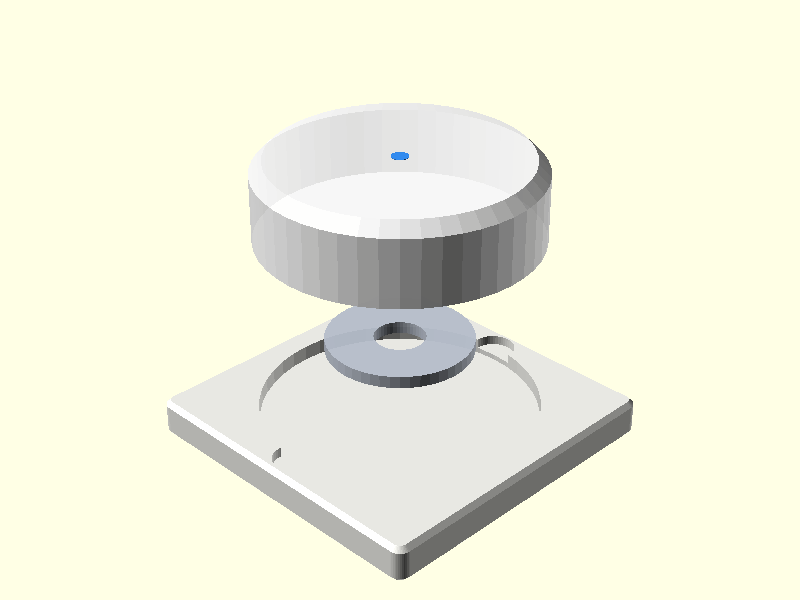
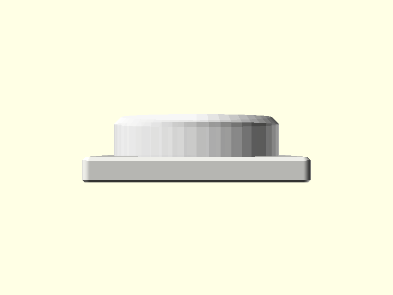
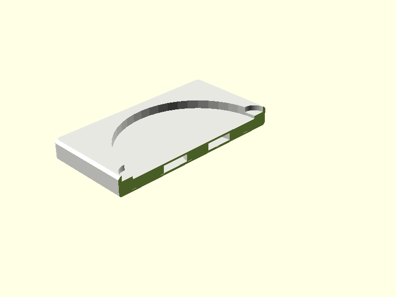
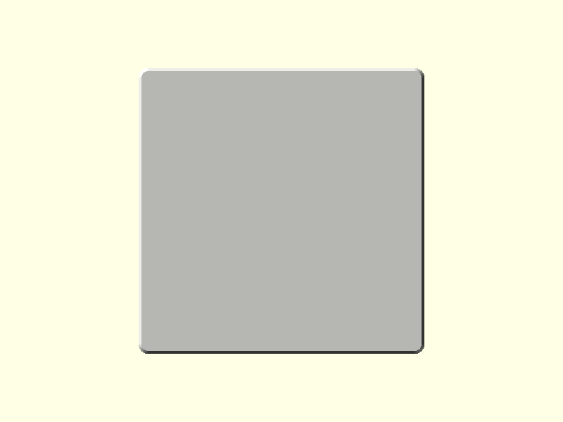

# Philips Hue Smart Button (Gen 2) Base for German Light Switches

A precision, fully parametric 3D-printable base plate and wall adapter designed for the **Philips Hue Smart Button (Second Generation / v2)**, engineered to integrate seamlessly into standard German domestic light switch installations (System 55 and DIN 49073).

---

## 💡 Overview & Features

The 2nd Generation Philips Hue Smart Button features an enlarged 45 mm circular body (up from 32 mm in Gen 1) and contains a powerful internal permanent magnet. This adapter provides:

- **German Light Switch Compatibility:**
  - **System 55 Insert (`54.7 mm × 54.7 mm`):** Fits standard 55 mm switch program cutouts (Gira System 55 / E2 / Standard 55, Jung AS 500 / A 500, Merten System M, Berker S.1 / B.3 / Q.1).
  - **Full Frame Wall Plate (`80.0 mm × 80.0 mm`):** Replaces existing decorative switch frames or covers German flush-mount wall boxes (Unterputzdose Ø68 mm). Includes standard **60.0 mm DIN 49073** screw hole spacing with countersinks for drywall/box screws and a rear cavity for wire terminal clearance.
- **Annular Washer Pocket with Solid Central Support Post:**
  - Standard **DIN 9021 M8 large fender washers** have an outer diameter of $24.0\text{ mm}$ and an inner hole of $8.4\text{ mm}$.
  - Instead of a wide, unsupported $24.8\text{ mm}$ disk void, the pocket is sculpted as an **annular ring** with an integrated **$\varnothing 8.0\text{ mm}$ solid central post**.
  - **Auto-Centering:** The washer drops over the central post and is mechanically locked into the dead center of the base.
  - **Drastically Reduced Overhang Span:** The bridging span is reduced from $24.8\text{ mm}$ down to just **$8.4\text{ mm}$**.
  - **Zero-Sag Center Anchor:** Pressing the button transmits force straight down through the central post to the wall with zero plastic flex or fatigue.
- **Two Ways to Enclose the Washer:**
  - **Method A — Internal Sealed Pocket (Default in `model.stl`):** 
    Add a **Pause at Layer** at $Z = 2.80\text{ mm}$ (Layer 14 at 0.20 mm layer height), drop the washer over the central post, and resume. The printer bridges over the annular gap and permanently encapsulates the washer inside solid plastic with a 100% smooth, seamless surface.
  - **Method B — Open Front Pocket + Flush Cover Cap ([`model_pocket_cap.stl`](model_pocket_cap.stl)):**
    If you prefer not to pause the print, use `model_system55_front_pocket.stl`. Drop in the washer after the print completes, and press or glue the flush cover cap over it.
- **Ergonomic Finger Notches:** Opposing subtle rim scallops allow effortless button removal with a fingernail when replacing the CR2032 coin battery.
- **FDM Optimized:** 100% support-free printing flat on $Z = 0$, with bottom chamfers to prevent elephant-foot distortion and top rim bevels.

---

## 📸 Multi-Angle Previews

| Isometric Exploded Assembly | Top View (Base Plate) | Side View |
| :---: | :---: | :---: |
|  |  |  |

| Cross-Section Cutaway (Showing Central Post & Annular Pocket) | Underside (Print Bed Flatness) |
| :---: | :---: |
|  |  |

---

## 🔍 How to Inspect the Closed Pocket in Your Slicer

When you open [`model.stl`](model.stl) or [`model_system55_internal_pocket.stl`](model_system55_internal_pocket.stl) in your slicer:

1. Click **Slice** to generate the G-code preview.
2. Drag the **vertical layer slider** on the right side of the screen:
   - **Layers 1–4 ($Z = 0.00 - 0.80\text{ mm}$):** 100% solid base layers.
   - **Layers 5–14 ($Z = 0.80 - 2.80\text{ mm}$):** The annular pocket ($\varnothing 24.8\text{ mm}$ outer, $\varnothing 8.0\text{ mm}$ inner post) is **OPEN** — drop your M8 washer over the central post!
   - **Layer 14 or 15 ($Z = 2.80\text{ mm}$ or $3.00\text{ mm}$):** **ADD PAUSE HERE**.
   - **Layers 15–17 ($Z = 2.90 - 3.50\text{ mm}$):** Solid bridge layers span the narrow $8.4\text{ mm}$ ring gap, bonding to both the outer rim and the central post, **SEALING THE POCKET SHUT**.
   - **Layers 18–30 ($Z = 3.50 - 6.00\text{ mm}$):** The outer rim and fingernail notches are printed, forming the recess for the Hue Smart Button.

---

## 📦 Pre-Exported STL Files

| STL File | Switch Format | Pocket Type | How Washer is Enclosed |
| :--- | :--- | :--- | :--- |
| [`model.stl`](model.stl) | System 55 (55x55 mm) | **Internal Sealed Pocket** (Default) | Slicer pause at $Z = 2.8\text{ mm}$; printer seals over it |
| [`model_system55_internal_pocket.stl`](model_system55_internal_pocket.stl) | System 55 (55x55 mm) | **Internal Sealed Pocket** | Slicer pause at $Z = 2.8\text{ mm}$; printer seals over it |
| [`model_full_frame_80x80_internal_pocket.stl`](model_full_frame_80x80_internal_pocket.stl) | Full Frame (80x80 mm DIN) | **Internal Sealed Pocket** | Slicer pause at $Z = 2.8\text{ mm}$; printer seals over it |
| [`model_system55_front_pocket.stl`](model_system55_front_pocket.stl) | System 55 (55x55 mm) | Open Front Pocket | Insert washer post-print, close with `model_pocket_cap.stl` |
| [`model_full_frame_80x80_front_pocket.stl`](model_full_frame_80x80_front_pocket.stl) | Full Frame (80x80 mm DIN) | Open Front Pocket | Insert washer post-print, close with `model_pocket_cap.stl` |
| [`model_pocket_cap.stl`](model_pocket_cap.stl) | Universal Cap | Flush Cosmetic Cover Disc | Drops/presses flush over washer in front pocket mode |

---

## 📐 Key Parameters (OpenSCAD)

All dimensions and features can be customized directly in the OpenSCAD Customizer:

| Parameter | Default Value | Description |
| :--- | :--- | :--- |
| `part` | `"all"` | Render mode: `"all"`, `"base"`, `"cap"`, `"system55"`, `"full_frame"`, `"exploded"`, `"debug"`, `"print_bed"` |
| `enable_center_post` | `true` | Solid central support post inside washer hole (drastically improves bridging) |
| `washer_center_post_dia` | `8.0 mm` | Center post diameter (fits DIN 9021 M8 washer with 8.4mm hole) |
| `pocket_position` | `"internal"` | Pocket style: `"internal"` (sealed by bridge layers), `"front"`, `"rear"` |
| `plate_type` | `"system55"` | Mount format: `"system55"` (55x55mm frame insert) or `"full_frame"` (80x80mm DIN 49073) |
| `sys55_size` | `54.7 mm` | System 55 insert width/height (0.3 mm clearance against standard 55.0 mm frames) |
| `full_frame_size` | `80.0 mm` | Full frame width/height matching single switch frames |
| `din_screw_spacing` | `60.0 mm` | German DIN 49073 center-to-center screw spacing |
| `button_dia` | `45.0 mm` | Official Hue Smart Button v2 outer diameter |
| `button_recess_depth` | `2.5 mm` | Recess depth (leaves 10.5 mm of button accessible) |
| `ferro_dia` | `24.8 mm` | Pocket outer diameter (DIN 9021 M8 washer has 24.0mm OD) |
| `ferro_depth` | `2.2 mm` | Pocket depth (accommodates 2.0mm washer + tolerance) |
| `front_skin_thickness` | `0.6 mm` | Thickness of solid ceiling bridging over washer (3 layers @ 0.2mm) |
| `enable_pry_notches` | `true` | Opposing fingernail scallops for battery replacement |
